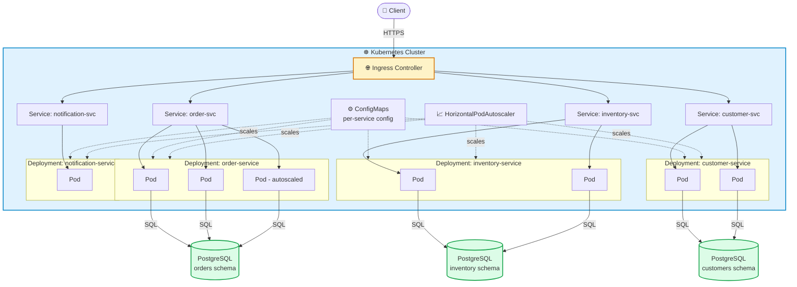
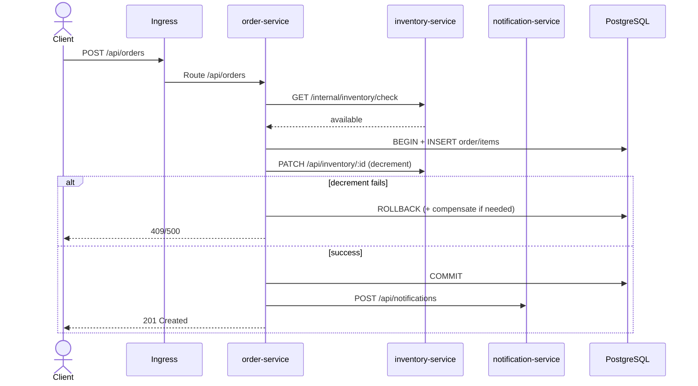
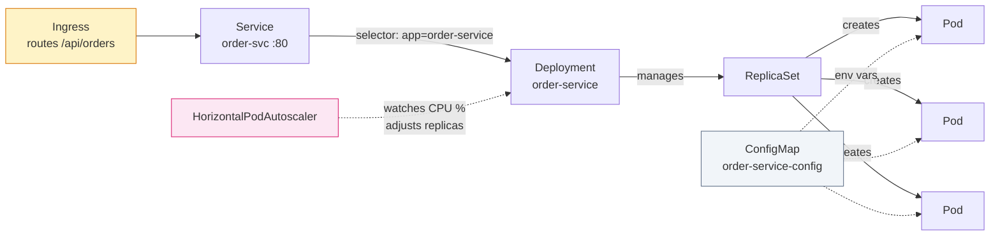
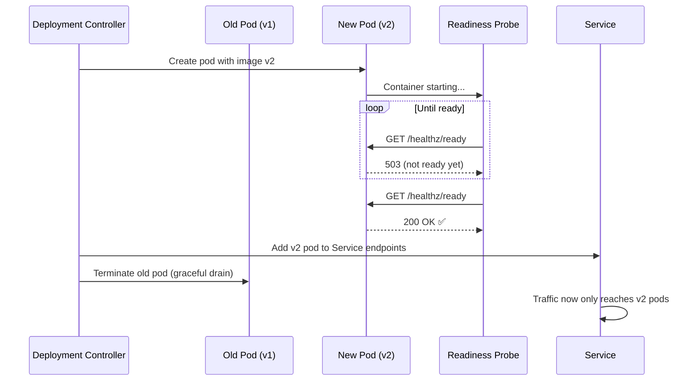
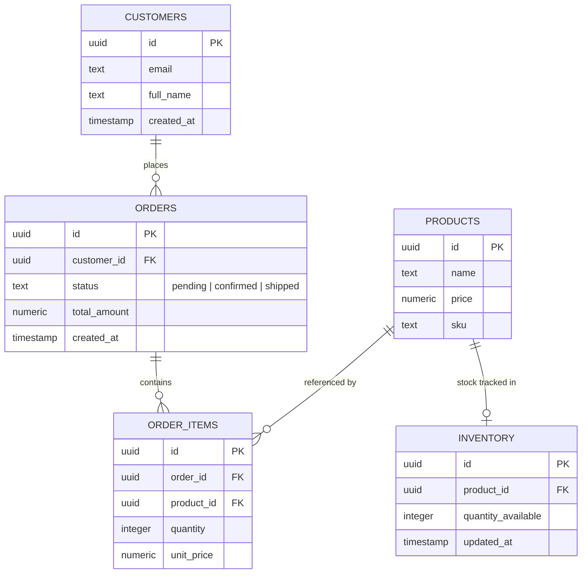
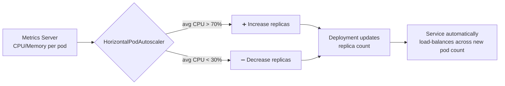

<div align="center">

# 🚢 OrderFlow

### Containerized Microservices on Kubernetes

*A monolith split into independently deployable services — scaled, self-healing, and zero-downtime.*

[](#)
[](#)
[](#)
[](#)
[](#license)

</div>

---

## 🧭 Table of Contents

- [Overview](#-overview)
- [Key Features](#-key-features)
- [System Architecture](#-system-architecture)
- [Request Flow](#-request-flow)
- [Kubernetes Object Model](#-kubernetes-object-model)
- [Rolling Updates & Health Probes](#-rolling-updates--health-probes)
- [Data Model](#-data-model)
- [Tech Stack](#-tech-stack)
- [Project Structure](#-project-structure)
- [API Reference](#-api-reference)
- [Getting Started](#-getting-started)
- [Configuration](#-configuration)
- [Scaling Behavior](#-scaling-behavior)
- [Roadmap](#-roadmap)
- [License](#-license)

---

## 🔍 Overview

**OrderFlow** is an order management system re-architected from a single monolithic app into a set of **independently deployable microservices**, orchestrated with Kubernetes. Each service owns a distinct piece of the domain (orders, inventory, customers, notifications), is packaged as its own Docker image, and is deployed, scaled, and updated independently of the others.

The project's focus is on **operational resilience**: services scale automatically under load via a `HorizontalPodAutoscaler`, unhealthy pods are detected and replaced via liveness/readiness probes, and new versions roll out with **zero downtime**.

> **Built for:** demonstrating cloud-agnostic, Kubernetes-native service decomposition — the same manifests run on EKS, GKE, AKS, or a local cluster with no code changes.

## 📌 Project Status / MVP scope

| Path | What it proves | Status |
|---|---|---|
| **Docker Compose e2e** | Multi-service API + Postgres locally (`docker compose up`, `scripts/e2e-compose.sh`) | Primary MVP verification path |
| **Kubernetes manifests** | Deployments, Services, ConfigMaps, Secrets, Ingress, HPAs under `k8s/` | Code ready; apply needs a local/cluster kubecontext |
| **Service mesh / Helm** | Istio/Linkerd, Helm charts | **Out of scope for MVP** — see Roadmap |

MVP = compose e2e + unit tests + checked-in K8s manifests. Cluster load tests, mesh, and Helm are post-MVP.

### MVP scope

| Path | What it proves | Status |
|---|---|---|
| **Docker Compose e2e** | Multi-service order → inventory → notification flow on one machine | Primary local demo (`scripts/e2e-compose.sh`) |
| **Kubernetes manifests** | Deployments, Services, probes, HPA, Ingress, rolling updates | Code ready; needs `kubectl` + cluster |
| **Service mesh / Helm** | Istio/Linkerd, Helm charts | **Out of scope for MVP** — see Roadmap |

---

## ✨ Key Features

| Feature | Description |
|---|---|
| 🧩 **Service Decomposition** | Order management split into independently deployable microservices |
| 📦 **Containerized** | Each service packaged as its own Docker image |
| ⚙️ **Declarative Infra** | Deployment, Service, ConfigMap, and Ingress manifests define the whole system |
| 📈 **Autoscaling** | `HorizontalPodAutoscaler` scales pods per-service based on CPU/load |
| 💓 **Self-Healing** | Liveness/readiness probes detect and replace unhealthy pods automatically |
| 🔄 **Zero-Downtime Deploys** | Rolling update strategy replaces pods gradually, never dropping traffic |
| 🌐 **Single Entry Point** | Ingress controller routes external traffic to the correct internal service |

---

## 🏗️ System Architecture

Each domain area of the order management app runs as its **own Deployment**, fronted by its own internal `Service`, all reachable through a single `Ingress`.



**Design principles:**
- **Independent deployability** — each service has its own Deployment, image, and rollout lifecycle; deploying `order-service` never touches `inventory-service`.
- **Database-per-service (logical)** — each service owns its own schema/tables, avoiding tight coupling through a shared data model.
- **Single ingress, many services** — clients only ever talk to one hostname; internal routing to the right service is handled by Ingress path/host rules.

---

## 🔄 Request Flow

Path of a request to place a new order: check stock → persist order → decrement inventory (fail = rollback) → notify:



---

## ☸️ Kubernetes Object Model

How the manifests relate to each other for a single service:



| Manifest | Role |
|---|---|
| **Deployment** | Declares desired pod count, container image, and update strategy for a service |
| **Service** | Stable internal DNS name + load-balances traffic across a Deployment's pods |
| **ConfigMap** | Injects non-secret configuration (env vars, feature flags) into pods |
| **Ingress** | Routes external HTTP(S) traffic to the correct internal Service by host/path |
| **HorizontalPodAutoscaler** | Watches CPU/memory metrics and adjusts replica count automatically |

---

## 💓 Rolling Updates & Health Probes



- **Readiness probe** — gates whether a pod receives traffic at all. A pod that fails readiness is removed from the Service's endpoints without being restarted.
- **Liveness probe** — detects a pod that's alive but stuck/deadlocked; Kubernetes restarts it automatically.
- **Rolling update strategy** — `maxSurge`/`maxUnavailable` control how many new pods come up and how many old pods go down at a time, ensuring capacity never drops to zero mid-deploy.

---

## 🗃️ Data Model

Logical domain model — in practice, each bounded context (service) owns and migrates only its own tables.



---

## 🧰 Tech Stack

| Layer | Technology | Purpose |
|---|---|---|
| **Language / Runtime** | Node.js | Each microservice's application code |
| **Containerization** | Docker | Packaging each service into a portable image |
| **Orchestration** | Kubernetes | Deployment, scaling, service discovery, self-healing |
| **Database** | PostgreSQL | Persistent storage, logically partitioned per service |
| **Traffic Routing** | Kubernetes Ingress | Single external entry point routed to internal services |
| **Scaling** | HorizontalPodAutoscaler | Automatic pod scaling based on resource metrics |

---

## 📁 Project Structure

```
orderflow/
├── services/
│   ├── order-service/
│   │   ├── src/
│   │   ├── Dockerfile
│   │   └── package.json
│   ├── inventory-service/
│   │   ├── src/
│   │   ├── Dockerfile
│   │   └── package.json
│   ├── customer-service/
│   │   ├── src/
│   │   ├── Dockerfile
│   │   └── package.json
│   └── notification-service/
│       ├── src/
│       ├── Dockerfile
│       └── package.json
│
├── k8s/
│   ├── order-service/        # deployment, service, configmap, hpa
│   ├── inventory-service/
│   ├── customer-service/
│   ├── notification-service/
│   ├── IMAGES.md             # local :latest vs GHCR :sha tags
│   ├── ingress.yaml
│   ├── secrets.yaml
│   └── namespace.yaml
│
├── scripts/
│   └── e2e-compose.sh        # compose smoke / integration script
├── docker-compose.yaml
├── TODO.md
└── README.md
```

---

## 📡 API Reference

Routed externally through Ingress at a single host, split by path prefix:

| Method | Endpoint | Service | Description |
|---|---|---|---|
| `GET` | `/api/orders` | order-service | List orders |
| `POST` | `/api/orders` | order-service | Create a new order (checks inventory internally) |
| `GET` | `/api/orders/:id` | order-service | Get order details |
| `GET` | `/api/inventory/:productId` | inventory-service | Get current stock level |
| `PATCH` | `/api/inventory/:productId` | inventory-service | Adjust stock level |
| `GET` | `/api/customers/:id` | customer-service | Get customer profile |
| `POST` | `/api/notifications` | notification-service | Trigger an order status notification |

---

## 🚀 Getting Started

### Prerequisites
- Docker + Docker Compose
- Node.js 24+ (for unit tests)
- `kubectl` + a local cluster (minikube, kind, or Docker Desktop) for K8s demos
- Ingress controller (e.g. `ingress-nginx`) for the Ingress path

### Local Development (Docker Compose)

```bash
git clone <this-repo>
cd OrderFlow
docker compose up --build -d

# Wait for health, then run the compose e2e smoke test
bash scripts/e2e-compose.sh
```

| Service | Local URL |
|---|---|
| order-service | http://localhost:3001 |
| inventory-service | http://localhost:3002 |
| customer-service | http://localhost:3003 |
| notification-service | http://localhost:3004 |
| postgres | localhost:5432 |

Quick demo (after compose is up):

```bash
# Create a customer
curl -s -X POST http://localhost:3003/api/customers \
  -H 'Content-Type: application/json' \
  -d '{"email":"demo@example.com","fullName":"Demo User"}'

# Place an order (uses seeded product-1)
curl -s -X POST http://localhost:3001/api/orders \
  -H 'Content-Type: application/json' \
  -d '{"customerId":"demo","items":[{"productId":"product-1","quantity":1,"unitPrice":9.99}]}'

# Confirm notification was recorded
curl -s http://localhost:3004/api/notifications
```

### Unit tests

```bash
for s in order-service inventory-service customer-service notification-service; do
  (cd services/$s && npm ci && npm test)
done
```

### Deploy to Kubernetes (local images)

Manifests default to **local** tags `orderflow/<service>:latest` (`IfNotPresent`). CI pushes **GHCR** tags `ghcr.io/<owner>/<repo>/<service>:<sha>` — see [`k8s/IMAGES.md`](k8s/IMAGES.md).

```bash
# Build & load images (kind example)
for s in order-service inventory-service customer-service notification-service; do
  docker build -t orderflow/$s:latest ./services/$s
  kind load docker-image orderflow/$s:latest
done

kubectl apply -f k8s/namespace.yaml
kubectl apply -f k8s/secrets.yaml
kubectl apply -f k8s/order-service/
kubectl apply -f k8s/inventory-service/
kubectl apply -f k8s/customer-service/
kubectl apply -f k8s/notification-service/
kubectl apply -f k8s/ingress.yaml

kubectl get pods,hpa -n orderflow
```

### Rolling update / rollback

```bash
kubectl -n orderflow set image deployment/order-service \
  order-service=orderflow/order-service:v2
kubectl -n orderflow rollout status deployment/order-service
kubectl -n orderflow rollout undo deployment/order-service
```

---

## ⚙️ Configuration

| Key | Where | Description |
|---|---|---|
| `DATABASE_URL` | Secret / compose env | Postgres URL for that service's database |
| `LOG_LEVEL` | ConfigMap | Logging verbosity (`info`, `debug`, `warn`) |
| `SERVICE_PORT` | ConfigMap | Listen port (default `3000`) |
| `INVENTORY_SERVICE_URL` | order ConfigMap | Cluster DNS / compose hostname for inventory |
| `NOTIFICATION_SERVICE_URL` | order ConfigMap | Cluster DNS / compose hostname for notifications |

Secrets (DB credentials) live in `k8s/secrets.yaml` (`orderflow-db-secret`), not ConfigMaps.

---

## 📈 Scaling Behavior



Each service defines its own `HorizontalPodAutoscaler` with independent min/max replica bounds and target thresholds — `order-service` (high traffic) scales more aggressively than `notification-service` (low, bursty traffic).

---

## 🗺️ Roadmap (post-MVP — not required for portfolio MVP)

- [ ] Add a service mesh (Istio/Linkerd) for mTLS + traffic policies between services
- [ ] Centralized logging (EFK/Loki stack)
- [ ] Distributed tracing (OpenTelemetry + Jaeger)
- [ ] Helm charts to replace raw manifests
- [ ] GitOps deployment via ArgoCD/Flux
- [ ] Network policies to restrict pod-to-pod traffic by default

---

## 📄 License

Distributed under the MIT License. See `LICENSE` for more information.

<div align="center">

**OrderFlow** — built with Docker, Kubernetes, Node.js & PostgreSQL

</div>
